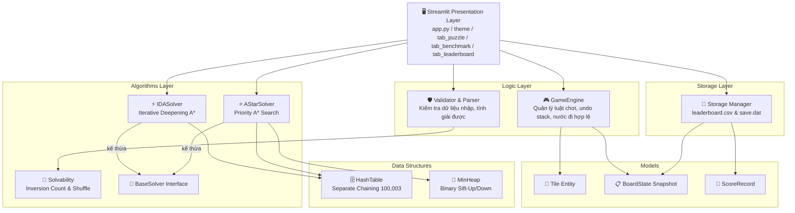

# 🧩 15-PUZZLE GAME & AI SOLVER

<p align="center">
  
  
  
  
  
  
</p>

---

## 📖 1. Giới Thiệu Dự Án (Overview)

**15-Puzzle** (Trò chơi trượt ô 15 số) là một bài toán kinh điển trong toán học giải trí và khoa học máy tính. Trò chơi bao gồm một khung lưới hình vuông kích thước $4 \times 4$, chứa 15 ô vuông được đánh số từ **1** đến **15** và một **vị trí ô trống (ký hiệu là 0)**. 

Người chơi chỉ được phép trượt các ô nằm liền kề (trên, dưới, trái, phải) vào vị trí ô trống. Mục tiêu cuối cùng là sắp xếp lại các ô từ trạng thái xáo trộn bất kỳ về **trạng thái đích chuẩn (Goal State)**:

$$\begin{bmatrix} 1 & 2 & 3 & 4 \\ 5 & 6 & 7 & 8 \\ 9 & 10 & 11 & 12 \\ 13 & 14 & 15 & 0 \end{bmatrix}$$

Dự án này là một hệ thống toàn diện được xây dựng bằng **Python 3.11+**, kết hợp các cấu trúc dữ liệu và giải thuật thuần túy (không phụ thuộc vào thư viện thuật toán có sẵn), kiến trúc Hướng đối tượng (OOP) phân tầng rõ ràng, cùng giao diện tương tác trực quan hiện đại qua **Streamlit**. Hệ thống tái hiện bảng màu **Catppuccin Mocha & C++ Raylib**, hỗ trợ điều khiển mượt mà bằng cả chuột và phím tắt, đồng thời tích hợp trình phát từng bước (AI Playback Controller) và công cụ đo lường hiệu năng chuyên sâu giữa hai thuật toán **IDA\*** và **A\***.

---

## ✨ 2. Các Tính Năng Nổi Bật (Key Features)

### 🎮 Trải Nghiệm Chơi Trò Chơi (Game Engine & Logic)
- **Chuẩn hóa quy tắc di chuyển**: Trượt ô hợp lệ, tự động cập nhật số bước (`Step Count`) và thời gian thực hiện (`Elapsed Time`).
- **Xáo bàn cờ ngẫu nhiên có bảo đảm**: Tự động đi ngược từ trạng thái đích $N$ bước ($10 \div 80$ bước), bảo đảm bàn cờ tạo ra **100% giải được**.
- **Bộ nạp màn chơi mẫu (Sample Levels)**: 
  - **Dễ (Easy)**: Cách đích 3 bước.
  - **Vừa (Medium)**: Cách đích 4 bước.
  - **Khó (Hard)**: Cách đích 13 bước (bản gốc C++ Raylib `levels/hard.txt`).
- **Nhập bàn cờ tùy biến (Custom Input)**: Nhập chuỗi 16 số phân tách bởi dấu phẩy, khoảng trắng hoặc xuống dòng; hệ thống tự động kiểm tra cú pháp và chứng minh tính giải được trước khi nạp vào bàn cờ.
- **Hoàn tác bước đi (Undo Stack)**: Cho phép hoàn tác không giới hạn các nước đi vừa thực hiện.
- **Phím tắt tiện lợi (Keyboard Shortcuts)**: Hỗ trợ phím mũi tên di chuyển, phím số chọn level, phím `R` xáo bài, `U` hoàn tác và `Space` gọi AI.

### 🤖 Trí Tuệ Nhân Tạo Giải Tự Động (AI Solver & Animation)
- **Thuật toán IDA\* (Iterative Deepening A\*)**:
  - Tối ưu hóa hàm đánh giá Heuristic Manhattan có trọng số: $f(n) = g(n) + 2.0 \cdot h(n)$.
  - Tích hợp bảng băm `HashTable` tự cài đặt để cắt tỉa chu trình (cycle-pruning) trên từng nhánh quay lui.
  - Tiết kiệm bộ nhớ vượt trội $O(d)$, giải quyết các bàn cờ xáo sâu trong chớp mắt (< 0.2s).
- **Thuật toán A\* Search**:
  - Hàng đợi ưu tiên Min-Heap nhị phân tự lập trình (`MinHeap`).
  - Quản lý tập đóng/mở tối ưu hóa chi phí $g$-score bằng `HashTable`.
- **Trình điều khiển mô phỏng bước đi (Interactive Playback Controller)**:
  - Tự động chạy lời giải theo nhịp với thanh chỉnh tốc độ mượt mà ($0.05s \div 1.0s$).
  - Nút tua từng bước (Next Step), lùi bước (Prev Step), tạm dừng (Pause) hoặc về trạng thái đích.

### 📊 Đối Đầu & Đo Lường Hiệu Năng (Benchmark: IDA\* vs A\*)
- So sánh trực tiếp trên cùng một trạng thái khởi tạo giữa hai thuật toán.
- Thống kê chi tiết: **Thời gian thực thi (ms)**, **Số nút duyệt mở rộng (Nodes Expanded)**, **Độ dài đường đi (Path Length)**.
- Tích hợp các bộ bàn cờ thử thách cực hạn (Challenge Boards) làm rõ giới hạn tràn bộ nhớ của $A^*$ và sự vượt trội của $IDA^*$.

### 🏆 Lưu Trữ & Bảng Xếp Hạng (Storage & Leaderboard)
- **Kỷ lục cá nhân (Top 10)**: Lưu trữ điểm số (tên người chơi, số bước, thời gian, ngày giờ) vào tệp chuẩn `data/leaderboard.csv`. Sắp xếp ưu tiên: ít bước hơn $\rightarrow$ thời gian ngắn hơn.
- **Lưu/Tải màn chơi (Save/Load State)**: Lưu tức thời snapshot bàn cờ vào `data/save.dat`.
- **Giao diện đa sắc (Dark/Light Theme)**: Chuyển đổi linh hoạt giữa giao diện tối huyền bí Catppuccin Mocha và giao diện sáng thanh lịch.

---

## 🏛️ 3. Kiến Trúc Hệ Thống (System Architecture)

Dự án được thiết kế chặt chẽ theo mô hình hướng đối tượng đa tầng, tách biệt rành mạch giữa **Mô hình Dữ liệu (Models)**, **Cấu trúc Dữ liệu Nền tảng (Structures)**, **Xử lý Nghiệp vụ & Luật chơi (Logic)**, **Thuật toán Tìm kiếm (Algorithms)**, **Lưu trữ Cục bộ (Storage)** và **Giao diện Người dùng (UI)**.

### Sơ Đồ Kiến Trúc Tổng Thể



---

## 📦 4. Cấu Trúc Dữ Liệu Tự Cài Đặt (Custom Data Structures)

Để bảo đảm tính tự chủ thuật toán và đạt điểm tuyệt đối về kỹ thuật lập trình nâng cao, toàn bộ các cấu trúc dữ liệu chính trong dự án đều được tự cài đặt từ đầu (Zero external DSA dependencies):

### 1. Bảng Băm Độc Lập (`HashTable` - `src/structures/hash_table.py`)
- **Phương pháp phân giải xung đột**: Separate Chaining (Danh sách liên kết / Mảng lồng).
- **Kích thước bảng**: Mặc định $cap = 100{,}003$ (số nguyên tố lớn giúp phân bố hàm băm đồng đều).
- **Hàm băm**: Tích hợp toán tử modulo trên giá trị băm nguyên bản của tuple 16 số: $\text{hash}(key) \pmod{cap}$.
- **Độ phức tạp thời gian**: Thao tác thêm (`put`), tìm kiếm (`get`/`contains`), xóa (`remove`) đạt kỳ vọng $O(1)$.
- **Ứng dụng**: 
  - Trong $IDA^*$: Lưu các trạng thái đang xét trên nhánh đệ quy hiện tại để nhận diện và loại bỏ tức thì các chu trình lặp lại, sau đó xóa vết khi quay lui (backtrack).
  - Trong $A^*$: Đóng vai trò là bảng tra cứu $g$-score tối ưu (`visited` / Closed Set).

### 2. Hàng Đợi Ưu Tiên Min-Heap (`MinHeap` - `src/structures/heap.py`)
- **Cấu trúc**: Cây nhị phân gần hoàn chỉnh lưu trữ trên mảng động tuyến tính 1 chiều.
- **Thuật toán cân bằng**:
  - `_sift_up`: Đẩy phần tử mới lên gốc khi thêm phần tử (`push`), chi phí $O(\log N)$.
  - `_sift_down`: Kéo phần tử từ gốc xuống khi lấy phần tử nhỏ nhất (`pop`), chi phí $O(\log N)$.
- **Ứng dụng**: Quản lý tập mở (Open Set) cho thuật toán $A^*$, bảo đảm nút có tổng ước lượng $f(n) = g(n) + h(n)$ nhỏ nhất luôn được xử lý trước mà không cần duyệt toàn bộ danh sách.

---

## 🧠 5. Cơ Sở Lý Thuyết & Thuật Toán AI

### 5.1. Định Lý Toán Học Về Tính Giải Được (Solvability Condition)
Không phải bất kỳ trạng thái hoán vị nào của 15 ô số cũng có thể đưa về trạng thái đích. Trong không gian trạng thái $16! \approx 2.09 \times 10^{13}$ trạng thái, chỉ có chính xác một nửa (khoảng $1.046 \times 10^{13}$) là giải được.

Đối với bàn cờ kích thước chẵn $4 \times 4$, điều kiện cần và đủ để bàn cờ giải được dựa trên **Số lượng nghịch thế ($N_{\text{inv}}$)** và **Vị trí hàng của ô trống ($R_{\text{blank}}$)**:

1. **Nghịch thế ($N_{\text{inv}}$)**: Đếm số cặp ô $(i, j)$ sao cho $i < j$ nhưng $tile[i] > tile[j]$ (bỏ qua ô trống mang giá trị 0).
2. **Hàng ô trống ($R_{\text{blank}}$)**: Vị trí hàng của ô 0 được đánh số từ **dưới lên trên**, bắt đầu từ 1 (Hàng dưới cùng = 1, hàng trên cùng = 4).

$$\text{Bàn cờ giải được} \iff (N_{\text{inv}} + R_{\text{blank}}) \pmod 2 = 1$$

Hàm kiểm tra trong `src/algorithms/solvability.py`:
```python
def is_solvable(state: tuple[int, ...]) -> bool:
    inversions = count_inversions(state)
    blank_idx = state.index(0)
    blank_row_bottom = 4 - (blank_idx // 4)
    return (inversions + blank_row_bottom) % 2 == 1
```

---

### 5.2. Hàm Đánh Giá Heuristic (Manhattan Distance)
Khoảng cách Manhattan được dùng làm hàm Heuristic cơ sở $h(n)$ vì tính chất **chấp nhận được (admissible)** và **nhất quán (consistent)**, không bao giờ đánh giá cao hơn chi phí thực tế:

$$h(n) = \sum_{i=1}^{15} \left( |row(i) - goal\_row(i)| + |col(i) - goal\_col(i)| \right)$$

Để tăng tốc độ định hướng cho AI trong không gian trạng thái rộng lớn của bàn cờ $4 \times 4$, thuật toán áp dụng **Trọng số Heuristic (Weighted Heuristic)** với hệ số $w = 2.0$:

$$f(n) = g(n) + w \cdot h(n) \quad (w = 2.0)$$

Việc gán trọng số $w = 2.0$ giúp thuật toán ưu tiên cực mạnh các nhánh có xu hướng tiến thẳng về đích, giảm số lượng nút phải duyệt từ hàng trăm nghìn xuống vài nghìn nút mà vẫn giữ lời giải cực kỳ ngắn gọn.

---

### 5.3. Thuật Toán IDA\* (Iterative Deepening A\*)
$IDA^*$ là sự kết hợp hoàn hảo giữa thuật toán tìm kiếm theo chiều sâu (DFS - Depth-First Search) về ưu điểm tiết kiệm bộ nhớ và $A^*$ về tính định hướng tối ưu theo hàm Heuristic:

1. Khởi tạo ngưỡng chi phí: $\text{threshold} = f(\text{root}) = w \cdot h(\text{root})$.
2. Thực hiện duyệt DFS quay lùi có chặn ngưỡng:
   - Nếu trạng thái hiện tại có $h = 0 \rightarrow$ Tìm thấy đích.
   - Nếu $f(n) > \text{threshold} \rightarrow$ Dừng nhánh và trả về giá trị $f(n)$ vượt ngưỡng này.
   - Tránh đi ngược bước vừa đi (`last_dir ^ 1`).
   - Sử dụng `HashTable` lưu nhánh đệ quy hiện tại để loại trừ chu trình lặp vô hạn.
3. Sau mỗi lượt lặp, nếu chưa đến đích, gán $\text{threshold}$ mới bằng giá trị $f$ nhỏ nhất bị cắt tỉa từ vòng trước.

### 5.4. So Sánh Bản Chất Kỹ Thuật: IDA\* vs A\*

| Tiêu Chí | IDA\* (Iterative Deepening A\*) | A\* Search (Priority Queue) |
| :--- | :--- | :--- |
| **Cấu trúc lưu vết** | Ngăn xếp đệ quy Call Stack + `HashTable` nhánh | `MinHeap` (Open Set) + `HashTable` (Closed Set) |
| **Độ phức tạp bộ nhớ** | **$O(d)$** (Tuyến tính theo độ sâu lời giải) | **$O(b^d)$** (Hàm mũ, cực kỳ tốn RAM) |
| **Bộ nhớ thực tế** | Chỉ vài Kilobytes | Dễ dàng vượt quá hàng trăm Megabytes |
| **Xử lý bàn cờ sâu ($d > 25$)** | **Thành công vượt trội (< 0.2s)** | Dễ chạm ngưỡng giới hạn nút (Timeout/OOM) |
| **Tính trọn vẹn (Completeness)** | Có (kết thúc khi tìm được nghiệm) | Có (nếu đủ tài nguyên bộ nhớ) |

---

## 📂 6. Cấu Trúc Thư Mục Dự Án (Project Structure)

```text
15-puzzle/
├── .streamlit/                   # Cấu hình giao diện Streamlit
├── data/                         # Thư mục cơ sở dữ liệu cục bộ
│   ├── leaderboard.csv           # Lưu trữ Top 10 kỷ lục người chơi
│   └── save.dat                  # Snapshot lưu trữ trạng thái ván đấu
├── src/                          # Mã nguồn chính của dự án
│   ├── algorithms/               # Module giải thuật AI
│   │   ├── __init__.py
│   │   ├── a_star_solver.py      # Bộ giải A* Search dùng MinHeap
│   │   ├── base_solver.py        # Interface BaseSolver trừu tượng
│   │   ├── ida_solver.py         # Bộ giải IDA* với hàm băm cắt chu trình
│   │   └── solvability.py        # Hàm toán học đếm nghịch thế & xáo cờ
│   ├── logic/                    # Nghiệp vụ trò chơi
│   │   ├── __init__.py
│   │   ├── engine.py             # GameEngine: di chuyển, hoàn tác, luật thắng
│   │   └── validator.py          # Kiểm tra tính giải được & phân tích đầu vào
│   ├── models/                   # Thực thể dữ liệu (Data Classes)
│   │   ├── __init__.py
│   │   ├── board_state.py        # Trạng thái lưới, số bước, đồng hồ
│   │   ├── record.py             # Bản ghi thành tích người chơi (ScoreRecord)
│   │   └── tile.py               # Ô cờ Tile (giá trị, tọa độ pixel)
│   ├── storage/                  # Module quản lý tệp tin
│   │   ├── __init__.py
│   │   └── storage.py            # Đọc/ghi leaderboard.csv & save.dat
│   ├── structures/               # Cấu trúc dữ liệu tự xây dựng
│   │   ├── __init__.py
│   │   ├── hash_table.py         # Bảng băm HashTable (Separate Chaining)
│   │   └── heap.py               # MinHeap nhị phân (Sift-Up/Down)
│   ├── ui/                       # Giao diện người dùng
│   │   ├── __init__.py
│   │   ├── tab_benchmark.py      # Tab so sánh đối đầu IDA* vs A*
│   │   ├── tab_leaderboard.py    # Tab bảng xếp hạng Top 10 & Lưu trữ
│   │   ├── tab_puzzle.py         # Tab chơi game & Trình diễn giải AI
│   │   └── theme.py              # Hệ thống CSS Catppuccin Mocha & Dark/Light
│   └── app.py                    # Điểm khởi động chính của ứng dụng
├── tests/                        # Kiểm thử tự động (Unit Tests)
│   ├── test_algo.py              # Test tính giải được & thuật toán IDA*
│   └── test_puzzle.py            # Test toàn diện Cấu trúc, Engine, Solver, Storage
├── pyproject.toml                # Cấu hình dự án, gói phụ thuộc & pytest
├── uv.lock                       # Lockfile của trình quản lý gói uv
└── README.md                     # Tài liệu hướng dẫn hoàn chỉnh của dự án
```

---

## 🚀 7. Hướng Dẫn Cài Đặt & Khởi Chạy (Installation & Usage)

### 7.1. Yêu Cầu Môi Trường
- **Python**: Phiên bản `3.11` trở lên.
- Trình quản lý gói: Khuyến nghị dùng **[uv](https://github.com/astral-sh/uv)** (tốc độ cao) hoặc `pip` truyền thống.

### 7.2. Cài Đặt Bằng `uv` (Khuyến Nghị)
```bash
# 1. Di chuyển vào thư mục dự án
cd 15-puzzle

# 2. Cài đặt toàn bộ môi trường và gói phụ thuộc tự động
uv sync
```

### 7.3. Cài Đặt Bằng `pip` & `venv` Truyền Thống
```bash
# 1. Tạo môi trường ảo
python -m venv .venv

# 2. Kích hoạt môi trường ảo
# Trên Windows PowerShell:
.venv\Scripts\Activate.ps1
# Trên Linux/macOS:
source .venv/bin/activate

# 3. Cài đặt các thư viện phụ thuộc
pip install streamlit pandas pytest
```

### 7.4. Khởi Chạy Trò Chơi
Chạy lệnh sau trên terminal để mở giao diện web trên trình duyệt:

```bash
# Sử dụng uv:
uv run streamlit run src/app.py

# Hoặc sử dụng môi trường python hiện hành:
streamlit run src/app.py
```
> Trình duyệt sẽ tự động mở tại địa chỉ: `http://localhost:8501`.

---

## 🧪 8. Kiểm Thử Tự Động (Automated Testing)

Dự án tích hợp bộ kiểm thử đơn vị tự động toàn diện qua **Pytest**, bao quát tất cả các trường hợp biên và cấu trúc lõi:

```bash
# Chạy kiểm thử với uv
uv run pytest -v

# Hoặc chạy trực tiếp với pytest
pytest -v
```

### Kết Quả Kiểm Thử (11/11 Test Cases Passed)
```text
tests/test_algo.py::test_algo_solvability PASSED                     [  9%]
tests/test_algo.py::test_ida_solver_execution PASSED                 [ 18%]
tests/test_puzzle.py::test_hash_table PASSED                         [ 27%]
tests/test_puzzle.py::test_min_heap PASSED                           [ 36%]
tests/test_puzzle.py::test_solvability PASSED                        [ 45%]
tests/test_puzzle.py::test_game_engine PASSED                        [ 54%]
tests/test_puzzle.py::test_ida_solver_short PASSED                   [ 63%]
tests/test_puzzle.py::test_a_star_solver_short PASSED                [ 72%]
tests/test_puzzle.py::test_score_record_sorting PASSED               [ 81%]
tests/test_puzzle.py::test_storage_game PASSED                       [ 90%]
tests/test_puzzle.py::test_storage_leaderboard PASSED                [100%]

============================= 11 passed in 0.24s ==============================
```

---

## 🎮 9. Hướng Dẫn Sử Dụng Chi Tiết (User Manual)

### 📌 Tab 1: Bàn Cờ & AI Solver (`tab_puzzle.py`)
1. **Chơi thủ công**:
   - Nhấp chuột trực tiếp vào bất kỳ ô số nào kề cạnh ô trống để trượt.
   - Sử dụng các phím mũi tên `↑`, `↓`, `←`, `→` trên bàn phím.
2. **Khởi tạo trạng thái**:
   - Chọn nhanh các cấp độ mẫu: `[1] Dễ (3 bước)`, `[2] Vừa (4 bước)`, `[3] Khó (13 bước)`.
   - Bấm `[R] Xáo Bàn Cờ` để xáo ngẫu nhiên từ 10 đến 80 bước.
   - Nhập ma trận 16 số tùy biến vào khung văn bản và bấm **"Nạp & Kiểm Tra"**.
3. **Giải tự động bằng AI**:
   - Chọn thuật toán AI mong muốn (`IDA*` hoặc `A*`).
   - Nhấn nút **"🧠 Tìm Lời Giải AI"** (hoặc bấm phím `Space`).
   - Sau khi có chuỗi bước đi, sử dụng **Thanh điều khiển Playback**:
     - `▶ Tự Động Chạy`: Mô phỏng từng bước di chuyển trực quan.
     - `⏸ Tạm Dừng`: Dừng lại tại bước hiện thời.
     - `⏮ Lùi 1 Bước` / `⏭ Tiến 1 Bước`: Xem chi tiết từng nước biến chuyển.
     - Điều chỉnh thanh trượt tốc độ phát từ `0.05s` (siêu nhanh) đến `1.0s` (chậm rãi).
4. **Lưu thành tích**: Khi hoàn thành màn chơi về trạng thái đích, nhập tên của bạn vào hộp thoại chiến thắng để lưu kỷ lục vào bảng vàng.

### 📌 Tab 2: So Sánh Thuật Toán Benchmark (`tab_benchmark.py`)
1. Lựa chọn nguồn bàn cờ đối đầu:
   - Xáo ngẫu nhiên với độ sâu tùy chỉnh ($10 \div 80$ bước).
   - Chọn bộ bàn cờ thử thách cực hạn độc quyền (**Thử Thách 1**, **Thử Thách 2**, **Bản Cờ C++ Hard**).
   - Tự nhập một trạng thái bàn cờ 16 số.
2. Bấm nút **"⚔️ Chạy Đối Đầu Thuật Toán (Benchmark)"**.
3. Quan sát bảng kết quả đo đạc song song:
   - Thời gian tính toán từng mili-giây.
   - Số nút duyệt thực tế trong bộ nhớ.
   - Độ dài chuỗi bước đi tìm được.
   - Đồ thị trực quan so sánh tỷ lệ tài nguyên sử dụng giữa hai giải thuật.

### 📌 Tab 3: Bảng Xếp Hạng & Lưu Trữ (`tab_leaderboard.py`)
1. Xem danh sách **Top 10 Kỷ Lục** người chơi xuất sắc nhất với huy chương vàng, bạc, đồng.
2. Quản lý trạng thái:
   - **💾 Lưu Game Tức Thời**: Chụp ảnh ván cờ hiện tại và lưu vào `data/save.dat`.
   - **📂 Tải Lại Game**: Phục hồi chính xác vị trí các ô, số bước và thời gian trước đó.
   - **🗑️ Dọn Sạch**: Xóa dữ liệu bảng xếp hạng khi cần reset môi trường.

---

## ⌨️ 10. Bảng Tra Cứu Phím Tắt (Keyboard Shortcuts)

Để đem lại cảm giác mượt mà và trực quan như một game native C++ Raylib, hệ thống tích hợp bộ bắt sự kiện phím toàn cục:

| Phím Tắt | Chức Năng Tương Ứng | Mô Tả |
| :---: | :--- | :--- |
| **`↑` `↓` `←` `→`** | Di chuyển ô cờ | Đẩy ô cờ tương ứng theo hướng mũi tên vào khoảng trống |
| **`Space`** | Kích hoạt AI Solver | Tự động chạy thuật toán tìm lời giải cho thế cờ hiện tại |
| **`R`** | Xáo bàn cờ ngẫu nhiên | Đặt lại và xáo ngẫu nhiên bảo đảm giải được 100% |
| **`U`** hoặc **`Ctrl + Z`** | Hoàn tác (Undo) | Lùi lại 1 bước vừa di chuyển |
| **`1`** | Nạp Level Dễ | Thế cờ cách trạng thái đích 3 bước |
| **`2`** | Nạp Level Vừa | Thế cờ cách trạng thái đích 4 bước |
| **`3`** | Nạp Level Khó | Thế cờ gốc C++ Raylib cách trạng thái đích 13 bước |

---

## 🎨 11. Bảng Màu Thiết Kế (Design System & Color Palette)

Dự án áp dụng phong cách thiết kế **Catppuccin Mocha Dark Navy** (#1E1E2E) kết hợp công thức sinh màu gradient tuyến tính chuẩn xác từ C++:

```text
Với mỗi ô số có giá trị `val` từ 1 đến 15:
  R = 30 + val * 14
  G = 60 + val * 8
  B = 180 - val * 6
```

- **Màu nền bàn cờ**: `#181825` (Màu tối trầm tĩnh, bo góc tròn 20px, hiệu ứng đổ bóng lõm).
- **Ô số (Tiles)**: Gradient xanh đậm sang tím hồng, hiệu ứng nổi 3D (`box-shadow`), viền bóng mềm.
- **Ô trống (Blank Tile)**: `#11111B` với viền nét đứt mảnh, tạo chiều sâu thị giác.
- **Typography**: Phông chữ hiện đại **Inter** cho giao diện người dùng và **JetBrains Mono** cho hiển thị số liệu/thời gian.

---

## 👥 12. Tác Giả & Bản Quyền (Credits & License)

- **Tác giả dự án**: Rainy ([truongvu360@gmail.com](mailto:truongvu360@gmail.com))
- **Mã nguồn Repository**: [DQGiac/15-puzzle](https://github.com/DQGiac/15-puzzle)
- **Giấy phép**: Phân phối theo chuẩn mã nguồn mở **MIT License**. Bạn được tự do học tập, sử dụng và phát triển dự án này.

<p align="center">
  <i>Được phát triển với niềm đam mê toán học, cấu trúc dữ liệu và nghệ thuật thuật toán.</i>
</p>
