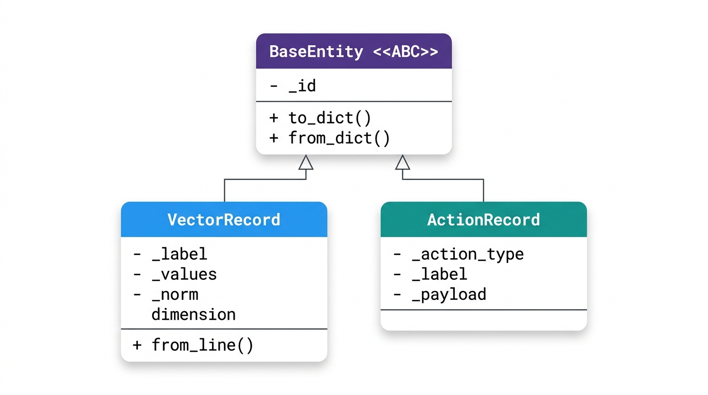
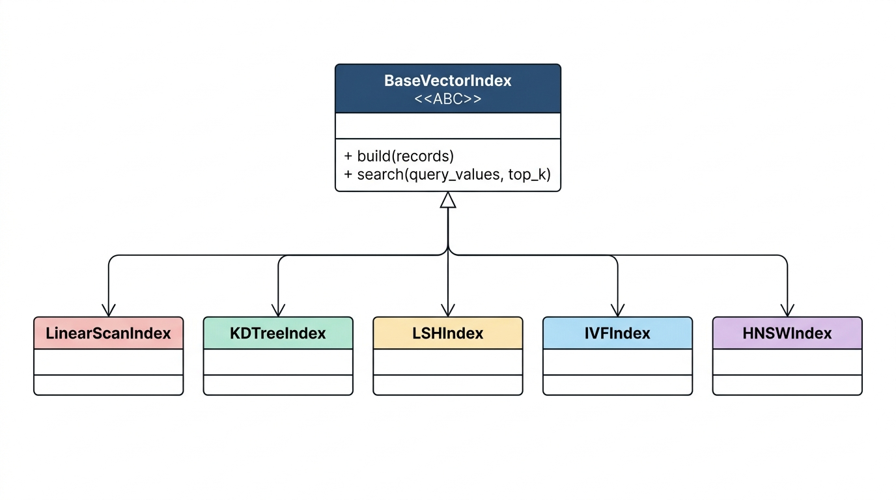
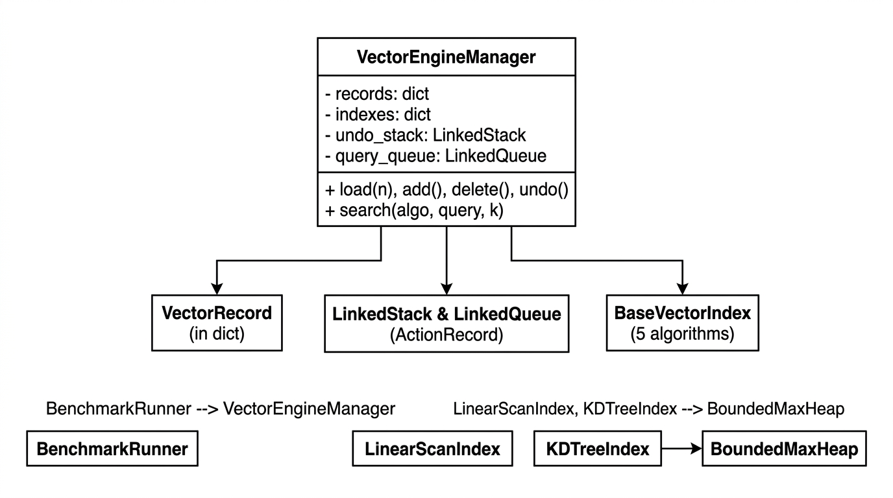
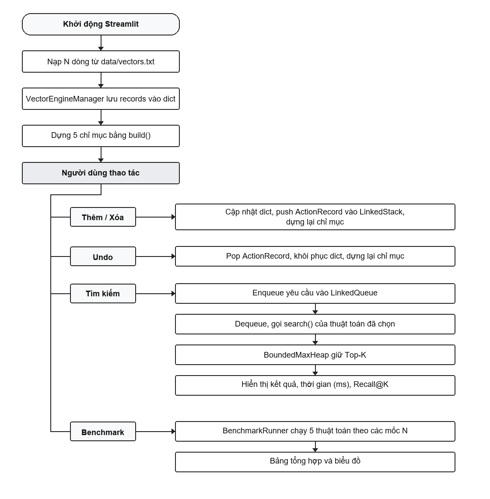
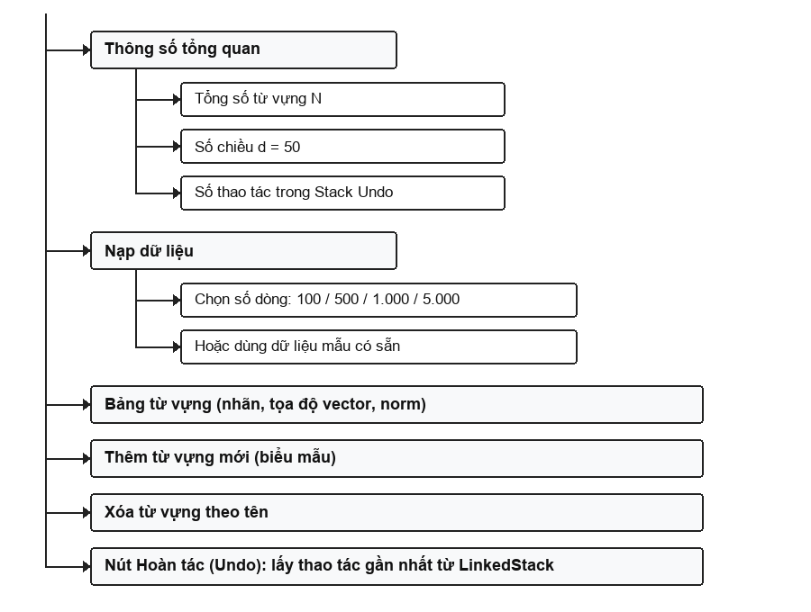
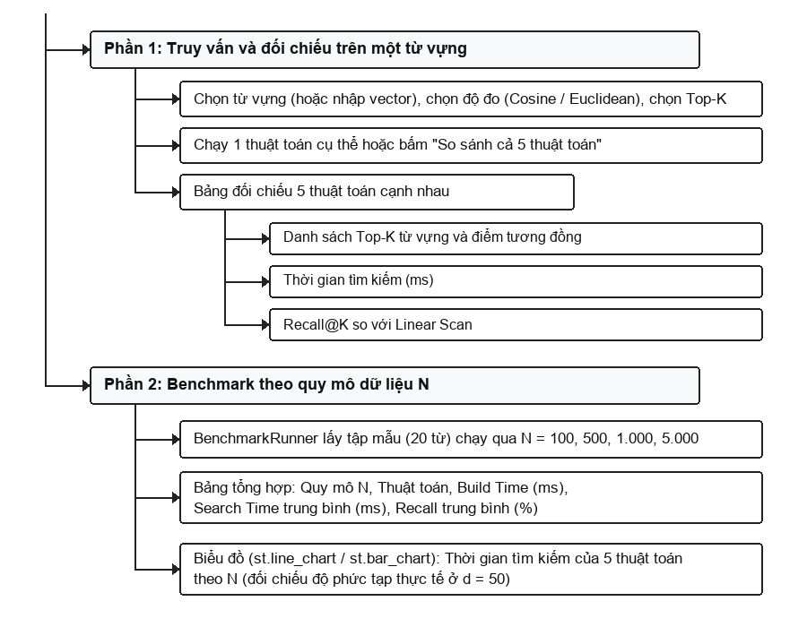

# Vector Search Engine (Mini FAISS / Milvus)
> **Xây dựng hệ thống quản lý và tìm kiếm vector tương đồng**

---

## 1. Giới thiệu đề tài và Mục tiêu

### 1.1. Bài toán
Đề tài xây dựng một hệ thống tìm kiếm vector tương đồng, thuộc bài toán **ANN (Approximate Nearest Neighbor - tìm láng giềng gần nhất xấp xỉ)**. Bài toán này phục vụ tìm kiếm ngữ nghĩa (**Semantic Search**) và là nền tảng của các kiến trúc **RAG** hiện đại. Hệ thống mô phỏng ở quy mô nhỏ hai hệ thống thực tế:
- **FAISS** (thư viện tìm kiếm vector của Meta)
- **Milvus** (cơ sở dữ liệu vector)

**Dữ liệu thực nghiệm:**
- Mỗi từ vựng tiếng Anh được biểu diễn bằng một vector gồm **50 số thực** (bộ Stanford GloVe, lưu trong `data/vectors.txt`, mỗi dòng có dạng `từ v1 v2 ... v50`).
- Các từ có nghĩa gần nhau (ví dụ: *king* và *queen*, *vietnam* và *hanoi*) có vector gần nhau về khoảng cách hoặc về góc.

**Ứng dụng cho phép:**
1. **Quản lý danh sách vector** (vai trò giống Milvus): đọc/ghi file, thêm, xóa, hoàn tác (Undo).
2. **Tìm K từ gần nhất** (Top-K Nearest Neighbors) bằng **5 thuật toán** (vai trò giống FAISS), so sánh tốc độ và độ chính xác.

---

### 1.2. Mục tiêu

| Nhóm | Nội dung |
| :--- | :--- |
| **OOP** | Lớp trừu tượng, kế thừa, đa hình, đóng gói (`BaseEntity`, `BaseVectorIndex`). |
| **Cấu trúc dữ liệu** | Tự cài đặt `LinkedStack`, `LinkedQueue`, `BoundedMaxHeap`; dùng `dict` để tra cứu $O(1)$. |
| **Giải thuật** | Tự cài đặt 5 thuật toán: **Linear Scan**, **KD-Tree**, **LSH**, **IVF-Flat**, **HNSW**. |
| **Thực nghiệm** | Đo thời gian dựng, thời gian tìm kiếm và Recall@K theo quy mô dữ liệu $N$. |

---

### 1.3. Công nghệ và ràng buộc

- **Ngôn ngữ**: Python 3.11+ (hoặc 3.12+), quản lý môi trường và gói phụ thuộc bằng `uv`.
- **Giao diện**: Streamlit, gồm 2 Tab chức năng.
- **Ràng buộc thư viện**:
  - Chỉ dùng kiểu dữ liệu và module cơ bản: `list`, `dict`, `set`, `tuple`, `math`, `random`, `time`.
  - **Tuyệt đối không dùng**: `heapq`, `collections.deque`, `numpy`, `scikit-learn`, `faiss` (toàn bộ cấu trúc dữ liệu và giải thuật phải tự code tay).

---

## 2. Cấu trúc thư mục và Thiết kế các lớp OOP

### 2.1. Cấu trúc thư mục dự án

```text
├── data/
│   ├── .gitkeep
│   └── vectors.txt                  # Từ vựng + vector 50 chiều (chuẩn GloVe)
├── src/
│   ├── models/
│   │   ├── base.py                  # BaseEntity (lớp trừu tượng)
│   │   ├── record.py                # VectorRecord
│   │   └── action.py                # ActionRecord (phục vụ Undo)
│   ├── core/
│   │   ├── algorithms/
│   │   │   ├── base.py              # BaseVectorIndex (lớp trừu tượng)
│   │   │   ├── linear_scan.py       # Thuật toán 1: Linear Scan
│   │   │   ├── kdtree.py            # Thuật toán 2: KD-Tree
│   │   │   ├── lsh.py               # Thuật toán 3: LSH
│   │   │   ├── ivf.py               # Thuật toán 4: IVF-Flat
│   │   │   └── hnsw.py              # Thuật toán 5: HNSW
│   │   ├── structures/
│   │   │   ├── stack.py             # LinkedStack
│   │   │   ├── queue.py             # LinkedQueue
│   │   │   └── heap.py              # BoundedMaxHeap
│   │   ├── storage.py               # Đọc/ghi data/vectors.txt
│   │   ├── metrics.py               # Cosine, Euclidean
│   │   ├── benchmark.py             # BenchmarkRunner
│   │   └── manager.py               # VectorEngineManager
│   └── app.py                       # Giao diện Streamlit 2 Tab
├── pyproject.toml
└── README.md
```

---

### 2.2. Các lớp thực thể (`src/models`)

| Lớp | Kế thừa | Thuộc tính chính | Vai trò |
| :--- | :--- | :--- | :--- |
| `BaseEntity` | `ABC` | `_id` (qua `@property id`) | Lớp cơ sở trừu tượng, khai báo `to_dict()` và `from_dict()`. |
| `VectorRecord` | `BaseEntity` | `_label`, `_values`, `dimension`, `_norm` | Lưu một từ vựng và vector. `_norm` = căn bậc hai của tổng bình phương, tính sẵn khi khởi tạo để tăng tốc Cosine. Có `from_line()` tách một dòng `vectors.txt`. |
| `ActionRecord` | `BaseEntity` | Loại thao tác (`ADD`, `DELETE`), nhãn từ, `payload` | Lưu dữ liệu cũ để khôi phục khi Undo. |

---

### 2.3. Class Diagram

#### Nhóm thực thể


#### Nhóm thuật toán (Đa hình qua `BaseVectorIndex`)


#### Lớp điều phối trung tâm (`VectorEngineManager`)


---

## 3. Cấu trúc dữ liệu tự cài đặt và 5 Thuật toán tìm kiếm

> **Ký hiệu**: $N$ là số vector, $d = 50$ là số chiều, $K$ là số kết quả cần tìm.

### 3.1. Cấu trúc dữ liệu tự cài đặt

| Cấu trúc | Cài đặt | Vai trò | Độ phức tạp |
| :--- | :--- | :--- | :--- |
| `dict` | `label -> VectorRecord` trong `VectorEngineManager` | Tra cứu, thêm, xóa một từ theo nhãn | $O(1)$ |
| `LinkedStack` | Danh sách liên kết đơn, nút `StackNode(data, next)` | Lưu `ActionRecord` cho Undo (LIFO) | `push`, `pop`, `peek`: $O(1)$ |
| `LinkedQueue` | Danh sách liên kết đơn, nút `QueueNode(data, next)`, hai con trỏ `front`, `rear` | Hàng đợi yêu cầu tìm kiếm (FIFO) | `enqueue`, `dequeue`: $O(1)$ |
| `BoundedMaxHeap` | Đống nhị phân cực đại trên mảng 1 chiều, tự viết `_sift_up()`, `_sift_down()` | Giữ $K$ vector gần nhất | Thêm/thay đỉnh: $O(\log K)$ |

**Ưu điểm tối ưu:**
- `LinkedQueue` không tốn $O(N)$ dồn mảng như `list.pop(0)`.
- `BoundedMaxHeap`: Đỉnh luôn là phần tử xa nhất trong $K$ phần tử đang giữ. Gặp vector mới gần hơn đỉnh thì thay đỉnh rồi `_sift_down()`. Tìm Top-K tốn $O(N \log K)$ thay vì sắp xếp toàn bộ $O(N \log N)$.

---

### 3.2. Lớp cơ sở `BaseVectorIndex`
Cả 5 thuật toán cùng định nghĩa hai phương thức đa hình:
- `build(records)`: Dựng cấu trúc dữ liệu từ danh sách bản ghi.
- `search(query_values, top_k)`: Trả về $K$ vector gần nhất kèm điểm số.

---

### 3.3. Chi tiết 5 Thuật toán

#### 1. Linear Scan (`LinearScanIndex`)
- **Cách hoạt động**: Duyệt tuần tự $N$ vector, tính khoảng cách tới vector truy vấn, đưa vào `BoundedMaxHeap` để giữ Top-$K$.
- **Độ phức tạp**: Tìm kiếm $O(N \cdot d)$ (cộng $O(N \log K)$ cho heap).
- **Đặc điểm**: Chính xác 100%, dùng làm đáp án chuẩn (**Ground Truth**) để tính Recall@K cho 4 thuật toán còn lại.

#### 2. KD-Tree (`KDTreeIndex`)
- **Dựng cây**: Đệ quy, tại tầng `depth` chọn trục `axis = depth % dimension`, sắp xếp theo trục, lấy điểm trung vị làm nút `KDTreeNode`, chia dữ liệu sang nhánh trái và phải.
- **Tìm kiếm**: Đi xuống nhánh chứa điểm truy vấn trước, sau đó quay lui. Chỉ xét nhánh còn lại nếu khoảng cách từ điểm truy vấn đến mặt phẳng chia nhỏ hơn khoảng cách lớn nhất trong `BoundedMaxHeap` (cắt tỉa).
- **Độ phức tạp**: Dựng $O(N \log N \cdot d)$; Tìm kiếm trung bình $O(\log N \cdot d)$.
- **Lưu ý**: Cắt tỉa dựa trên khoảng cách Euclidean. Khi dùng độ đo Cosine, chuẩn hóa vector về độ dài 1 trước khi dựng cây (khi đó thứ tự theo Euclidean và theo Cosine là như nhau). Với $d = 50$, hiệu quả cắt tỉa giảm do **lời nguyền số chiều (curse of dimensionality)**.

#### 3. Random Hyperplane LSH (`LSHIndex`)
- **Dựng bảng băm**: Sinh $m$ siêu phẳng ngẫu nhiên qua gốc tọa độ. Với mỗi vector, tính tích vô hướng với từng siêu phẳng: $\ge 0$ ghi bit 1, $< 0$ ghi bit 0, tạo mã băm $m$-bit (ví dụ `10110010`). Vector có góc gần nhau thường cùng mã băm và rơi vào cùng ngăn `buckets[hash_key]`.
- **Tìm kiếm**: Băm vector truy vấn, lấy các vector trong cùng ngăn (hoặc các ngăn lệch 1 bit) rồi tính khoảng cách để chọn Top-$K$.
- **Độ phức tạp**: Dựng $O(N \cdot m \cdot d)$; Tìm kiếm $O(m \cdot d + B \cdot d)$ với $B$ là số phần tử trong các ngăn được xét ($B \ll N$).
- **Đặc điểm**: Thuật toán xấp xỉ (Recall có thể dưới 100%). Mã băm dựa trên góc giữa các vector nên phù hợp nhất với độ đo Cosine.

#### 4. IVF-Flat (`IVFIndex`)
- **Dựng chỉ mục**: Tự cài đặt $K$-Means gom $N$ vector thành $C$ cụm, mỗi cụm có một tâm centroid. Lưu vector của từng cụm trong `inverted_lists` (chỉ mục đảo).
- **Tìm kiếm**: So sánh truy vấn với $C$ tâm cụm, chọn `nprobe` cụm gần nhất, chỉ duyệt vector trong các cụm đó.
- **Độ phức tạp tìm kiếm**: $O(C \cdot d + \text{nprobe} \cdot (N/C) \cdot d)$.
- **Đặc điểm**: Tăng `nprobe` thì Recall tăng nhưng tốc độ sẽ chậm hơn.

#### 5. HNSW (`HNSWIndex`)
- **Dựng đồ thị**: Nhiều tầng, ý tưởng tương tự Skip List. Mỗi nút `HNSWNode` được sinh ngẫu nhiên một tầng tối đa theo phân phối mũ giảm dần. Tầng trên cùng ít đỉnh với cạnh nối xa để di chuyển nhanh; tầng 0 chứa toàn bộ $N$ đỉnh.
- **Tìm kiếm**: Bắt đầu từ đỉnh vào ở tầng cao nhất, nhảy tham lam sang đỉnh gần hơn, đi dần xuống tầng 0, rồi tìm lân cận trên tầng 0 để lấy Top-$K$.
- **Độ phức tạp tìm kiếm**: $O(\log N \cdot d)$ (xấp xỉ, phụ thuộc tham số).

---

### 3.4. Bảng tổng hợp 5 thuật toán

| Thuật toán | Dựng chỉ mục | Tìm kiếm | Độ chính xác | Ý tưởng chính |
| :--- | :--- | :--- | :--- | :--- |
| **Linear Scan** | Không cần | $O(N \cdot d)$ | Chính xác 100% | Duyệt toàn bộ |
| **KD-Tree** | $O(N \log N \cdot d)$ | TB $O(\log N \cdot d)$ | Chính xác | Chia không gian, cắt tỉa |
| **LSH** | $O(N \cdot m \cdot d)$ | $O(m \cdot d + B \cdot d)$ | Xấp xỉ | Băm theo siêu phẳng |
| **IVF-Flat** | $K$-Means | $O(C \cdot d + \text{nprobe} \cdot \frac{N}{C} \cdot d)$ | Xấp xỉ | Phân cụm, chỉ mục đảo |
| **HNSW** | Xây đồ thị phân tầng | $O(\log N \cdot d)$ | Xấp xỉ | Đồ thị nhỏ phân tầng |

---

## 4. Luồng hoạt động và Thiết kế giao diện

### 4.1. Luồng hoạt động chính


**Quy trình so sánh 5 thuật toán trên một từ vựng:**
1. Người dùng chọn từ truy vấn, độ đo (Cosine / Euclidean) và giá trị $K$.
2. Hệ thống chạy **Linear Scan** để lấy đáp án chuẩn (**Ground Truth**).
3. Hệ thống chạy 4 thuật toán còn lại, đo thời gian thực thi bằng `time.perf_counter()`.
4. Tính $\text{Recall@K} = \frac{\text{Số từ trùng với đáp án chuẩn}}{K}$ (ví dụ: $4/5 = 80\%$).

---

### 4.2. Giao diện Streamlit (2 Tab)

#### Tab 1: Quản lý dữ liệu vector
*Xem danh sách vector, thêm từ mới, xóa từ, hoàn tác (Undo).*


#### Tab 2: Tìm kiếm tương đồng và so sánh 5 thuật toán
*Chọn từ khóa, chọn $K$, so sánh tốc độ và độ chính xác Recall giữa các thuật toán.*

